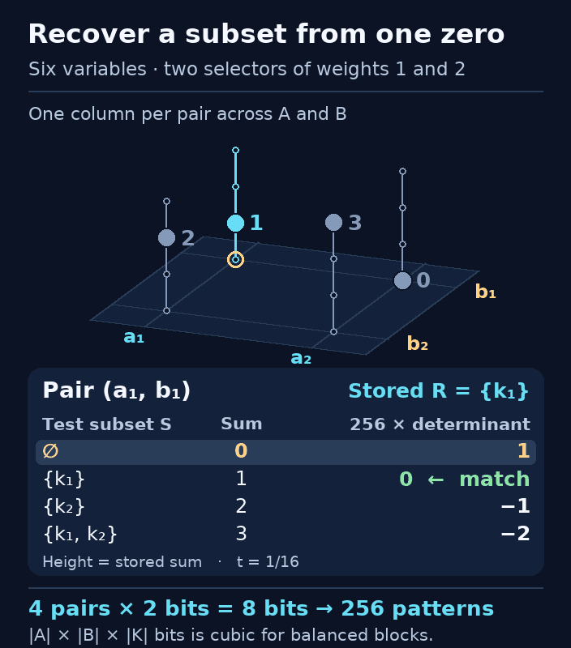

# Counting realizable gaussoids over infinite fields

  

How fast does the number of realizable gaussoids grow with the number of labelled variables? The original question appears in [Boege, dissertation, Conjecture 7.3](https://tboege.de/research/dissert.pdf#page=140).

**Result.** For each infinite field the logarithm of the number of principally regular symmetric-matrix conditional-independence patterns is Θ(n³). The same estimate holds over each ordered field with all principal minors positive.

[Read the paper (PDF)](paper/manuscript.pdf) · [LaTeX source](paper/manuscript.tex) · [Proof guide](proof/PROBLEM_AND_PROOF.md) · [Reproduce the checks](REPRODUCIBILITY.md)

## Explore the proof in 3D

Each column stores a subset. Its solid dot is the stored sum. The ring is your guess. When their heights match, the determinant is zero and you have recovered the subset. [Download the offline explorer](https://github.com/DannyExperiments/realizable-gaussoids-cubic-growth/raw/refs/heads/main/visualization/subset-encoding-explorer.zip), unzip it and open `index.html` to rotate the columns, change what they store and test your guess.

## How the construction works

A symmetric matrix determines a pattern of conditional independences. Each statement in the pattern records that a particular determinant is zero. To count patterns from below, we want to encode choices in matrices so that someone who sees only the pattern can recover every choice.

Split six labels into two left endpoints, two right endpoints and two selectors. Give the selectors weights 1 and 2. Their four subsets have four distinct sums. For each of the four left–right pairs, independently choose a subset to store. Testing another subset at that pair gives a determinant proportional to the stored sum minus the tested sum. Exactly one of the four tests returns zero. Thus the patterns distinguish all $4^4=256$ choices.

For $n$ labels, three balanced groups give on the order of $n^2$ pairs and $n$ selector bits per pair. That is where the cubic exponent comes from. The paper gives the field-specific choice of weights and proves the matrices can meet the principal-minor conditions. Combined with Boege’s upper bound, the construction determines the order of growth. The fraction realizable arbitrarily near the identity remains open.

## What you can check

The [six-variable replay](verification/src/replay.py) distinguishes all 256 assignments and checks 16,384 principal determinants for positivity over the rationals. The [proof](paper/manuscript.pdf) supplies the general result over infinite fields. The [figure guide](visualization/README.md) gives the exact matrix scale and rendering instructions.

Internally reviewed, not peer reviewed. [Mathematical audit](audits/public_safe_reports/MATHEMATICAL_AUDIT.md) · [Literature and priority](audits/public_safe_reports/LITERATURE_AUDIT.md) · [Citation](CITATION.cff)
