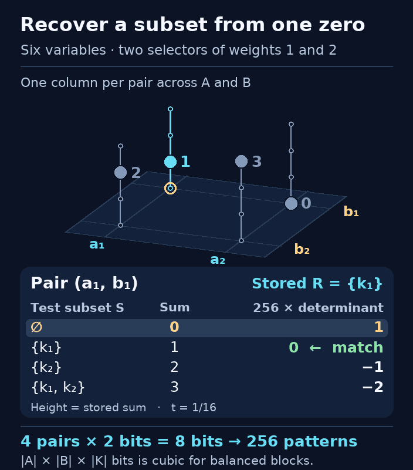

# Recover a subset from one zero

The [offline explorer](subset-encoding-explorer.zip) contains a single HTML file. Extract it and open it in a browser. Drag the diagram or use its rotation slider. Pick a pair, change its stored subset, and test a conditioning set. The table updates from the corresponding rational matrix.

## Read the diagram

- Use A = {a₁, a₂}, B = {b₁, b₂} and K = {k₁, k₂}. The selector weights 1 and 2 give the distinct subset sums 0, 1, 2 and 3.
- The solid dot is the stored sum for that pair. The ring is the sum being tested. With t = 1/16, the displayed integer is 256 times the almost-principal determinant, equal to the stored sum minus the tested sum. The zero occurs at one subset, which tells us what that pair stored.
- Four pairs independently encode two bits each, so their choices distinguish 256 full patterns. More generally, the product |A|·|B|·|K| gives the number of bits in the construction. It has cubic order for balanced blocks.

The quantifiers and positivity and field arguments are in the [proof](../proof/PROBLEM_AND_PROOF.md). The [independent six-variable replay](../verification/src/replay.py) checks all 256 rational choices.

## Rebuild

From this directory use Python 3.12, Pillow 13.0.0, and the DejaVu Sans regular and bold fonts. Supply the local paths to the fonts.

    python3 render.py --regular-font /path/to/DejaVuSans.ttf \
      --bold-font /path/to/DejaVuSans-Bold.ttf

This rebuilds the GIF and the explorer ZIP. The renderer verifies all 16 pair/subset tests and all 64 principal minors of the selected rational matrix with exact arithmetic, then checks dimensions, frame count and timing. The HTML evaluates the minors directly using exact integer arithmetic. Rebuilding with the same Pillow and FreeType versions and font files produced byte-identical output.
